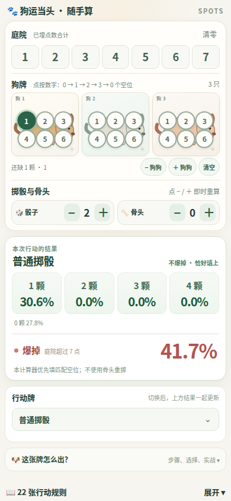

# Spots Table Companion · 狗运当头随手算

**Free, unofficial, Chinese-language companion** for CMYK's Spots dice game. A single offline-capable HTML page, not a replacement for the physical game.

## 在线打开 · 中文快速上手

**[直接打开网页版（GitHub Pages）](https://bibobrain.github.io/spots-table-companion/)**

**[下载离线 ZIP](https://github.com/bibobrain/spots-table-companion/releases/download/v1.0.0-rc.2/SpotsTableCompanion_1.0.0-rc2.zip)** · [版本详情](https://github.com/bibobrain/spots-table-companion/releases/tag/v1.0.0-rc.2)

庭院点数选择 **1–7**（再点一次清零），然后点亮狗牌还缺的数字；调整骰子与骨头（0–10 根），就能看到「不爆掉、恰好填上 1–4 颗」以及「爆掉」的概率。下方可选择 **22 张行动牌**，上方结果同步变化。点开「这张牌怎么出？」可逐步练习，教程示例支持一键恢复真实桌面。

概率使用页面明确写出的投骰、放骰及重掷策略，不代表所有可能策略中最优或整局胜率；实物规则与牌面优先。无需账号、无需安装。页面为**简体中文**，可保存 index.html 离线使用。

## What it does · 功能

* Select 1–7 buried yard spots (tap the chosen value again for 0).
* Tap dog spots to mark missing numbers (up to three of each number per illustrated dog).
* Adjust dice and treats (0–10 treats).
* See mutually exclusive probabilities of safely filling exactly 1, 2, 3 or 4 slots, along with bust odds.
* Choose among **22 trick tiles**; results change with the selected action.
* Learn actions through three-step demonstrations and quizzes. Training examples save and restore your actual tabletop.

**Current interface: Simplified Chinese.** The original game's title, trademarks and official artwork belong to their owners.

## Play online / offline

Once published, open the GitHub Pages home page. There is no login or app installation. To use offline, save `index.html` and open it with a browser.

## Probability scope

This is an aid for your selected **known** board state. The displayed dice-placement and treat-reroll strategy is **not guaranteed to be optimal play**; the probability is not a whole-game winning percentage. The ordinary default rerolls a batch only after failing to safely fill any slot. Track permits selected dice to be rerolled. An unknown next dog card cannot be simulated without its spaces.

The app assumes enough dice in the shared supply for dice-rolling calculations. Some tricks, including Dig and Dogpile, require actual physical dice information. Printed rules prevail in any conflict.

## Deploy to GitHub Pages

1. Create a **new public repository** named `spots-table-companion` (or your preferred name).
2. Upload **only this distribution's files**. Keep unrelated private workspace files out of the public repository.
3. Open **Settings → Pages → Build and deployment**. Choose **Deploy from a branch**, branch `main` and folder `/ (root)`.
4. After Pages finishes, open the actual page in a private browser window and test on a phone.
5. The typical address format is `https://USERNAME.github.io/spots-table-companion/`; replace the name with your own. **No live URL is claimed until actually verified.**

Run python3 tests/test_release.py locally before publishing or changing the page. A separate independent probability browser test requires Python websockets and Chrome: `pip install websockets; python tests/test_browser_probability.py`.

## Bug reports and feedback

In a GitHub Issue, include the trick name, yard total, missing spots, dice, treats, other action parameters, expected outcome and actual outcome. Do not post personal information.

## License, privacy and attribution

Original code and custom UI artwork are MIT-licensed. Trademarks, title, original rules and official card artwork are **not** included in that grant. See [LICENSE](LICENSE) and [NOTICE](NOTICE.md).

The app does not send your game state, use tracking scripts, access local storage or require an account. GitHub Pages and outbound official rule links have their own hosting/service policies.

Original game: [CMYK Spots](https://www.cmyk.games/products/spots) · [Rules](https://www.rulespal.com/spots/rulebook) · [BGG listing](https://boardgamegeek.com/boardgame/372559/spots).
